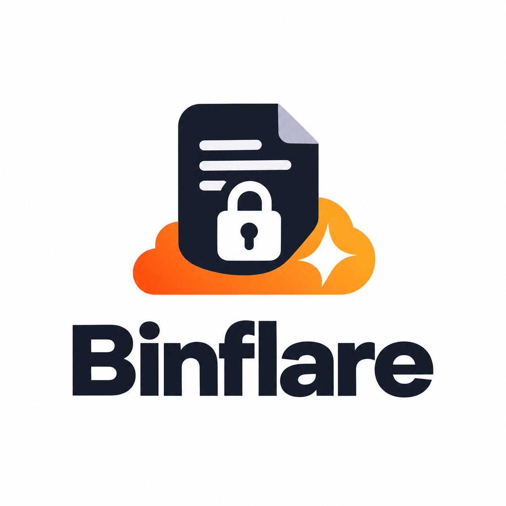

<p align="center">
  
</p>

# Binflare

**跑在 Cloudflare Workers + D1 上的零知识粘贴板，使用 PrivateBin v2 协议。**

粘贴在浏览器端完成加密后再上传。服务端只保存密文，以及过期、焚毁、评论和删除所必需的最小元数据。解密密钥只存在于 URL 的 `#fragment`，不会发送到服务端。

## 协议兼容

Binflare 实现 **PrivateBin 2.1.0 的 v2 线格式与 JSON API**：

- 现有 PrivateBin 客户端只需把 base URL 指向 Binflare，即可继续使用相同的粘贴格式、fragment 密钥、过期选项、评论和删除链接。
- 协议基线固定在 [`docs/PROTOCOL.md`](docs/PROTOCOL.md)；不支持 v1/ZeroBin。
- Binflare **不导入、不迁移**已有实例中的粘贴。改域名只对目标实例上已有的数据生效；旧粘贴留在原实例。

> **Binflare 是独立实现，与 PrivateBin 项目无隶属、无背书，也不是官方移植。** PrivateBin 版权归 Sébastien Sauvage 及贡献者，使用 Zlib/libpng 许可证。见 [NOTICE](NOTICE)。

## 能力

- 创建、读取、过期、阅后即焚、删除令牌。
- 可选口令保护（纯客户端；无法找回）。
- 纯文本、Markdown、语法高亮，带预览和行号。
- 评论 / 开放讨论，含回复、昵称和客户端确定性头像（不使用 IP 派生元数据）。
- 附件：多文件、拖放、剪贴板粘贴、移除、文件名/大小、图片/SVG 消毒/音频/视频/PDF/文本预览、下载、克隆。
- 分享：复制链接/正文、下载、原始文本、邮件、二维码、克隆；克隆会写入版本链 `children`。
- 预渲染 SPA 壳；粘贴内容只在浏览器拉取和解密，服务端不做粘贴内容的 React SSR。
- 小密文存 D1，大密文透明转 R2；首次读取原子焚毁、读时过期判定、Cron 清理。
- 英/简中 UI、明暗主题、可选 Turnstile，以及按 IP 的写入限流。

## 工作方式

```
浏览器（静态 SPA 壳）
  ├─ /?<id>#<key>       创建 / 查看 / 焚毁确认
  ├─ /api/*             REST 别名
  └─ fetch
       └─ Cloudflare Worker
            ├─ /         PrivateBin 兼容 JSON API
            ├─ /api/*    REST API
            ├─ D1        pastes、comments、rate_limits
            ├─ R2        大密文
            └─ Cron      过期清理
```

- SPA 壳在构建时预渲染；React 不在服务端渲染粘贴页面。
- 根路径同时提供 PrivateBin 兼容 API（`status: 0/1`、`?pasteid=`、`?id#key`、删除链接）和 SPA 壳；`/api/*` 用普通 HTTP 状态码提供同一组操作。
- 存储使用 D1（小密文）和 R2（大密文）；API 仍返回一个 PrivateBin v2 `ct`。阅后即焚在一个 D1 batch 事务内完成：读取并删除粘贴及其评论；并发首读只有一个读者能拿到 payload。

## 安全模型

- 加密只在客户端进行：新粘贴使用 AES-GCM；密钥由 256 位随机 fragment key 加可选口令派生。服务端永远收不到密钥或口令。
- 服务端保存密文和策略所需的元数据：过期、格式、讨论/焚毁标记、评论时间、密文大小。AAD 覆盖格式/讨论/焚毁标记；过期由服务端强制执行。
- 粘贴 ID 是协议规定的密文 FNV-1a64 校验和。删除令牌是 HMAC-SHA256(paste ID, 每个 paste 的 salt)；salt 永不下发。
- 评论沿用粘贴密钥；评论正文和昵称都加密。
- HTML 壳使用严格脚本 CSP（脚本不使用 `unsafe-inline`）、`Referrer-Policy: no-referrer`、`X-Frame-Options: DENY`、`noindex`；API 响应 `no-store`。
- 无账户、无 Cookie、无分析、无第三方字体或脚本（可选 Turnstile 除外）。

### 限制

- **粘贴大小**：D1 单行/单值上限 2,000,000 字节。Binflare 将最多 1.875 MB 密文存 D1，更大密文转 R2，默认上限 10 MB；附件在密文内共享该上限。没有 R2 绑定时上限为 1.875 MB。
- **R2 清理**：焚毁/删除/过期会在 D1 行删除后删除 R2 对象；如果 R2 删除失败，D1 行已不存在但密文可能成为桶内孤儿。严格清理可用 R2 生命周期规则或人工清理。
- **D1 单主库**（未开启读复制）：主库写后读一致；远端客户端承担一个往返延迟。
- **无原生 TTL**：过期粘贴读取时返回通用「不存在」；物理删除由读时清理和 Cron 完成。
- **焚毁依赖诚实服务端**：首次读取即删，但恶意运营者可以保留副本；任何服务端粘贴板都同理。
- **运营者可以替换 JavaScript**：任何浏览器端零知识工具都无法完全防住被篡改的部署；CSP 和审查只能降低风险。
- **`ctr`/`cbc` 仅只读兼容**：无认证，界面会标注警告；Binflare 新建始终用 AES-GCM。
- **焚毁 + 口令是破坏性的**：客户端会在读取焚毁链接前询问口令，但读取本身就会销毁文档；口令错误也会消耗掉它。
- **评论**：无分页、不能单条删除；随粘贴一起删除。
- **不迁移数据**：不导入已有 PrivateBin 粘贴；协议兼容，但数据不搬家。
- **未实现**：v1/ZeroBin、JSON-LD、短链代理、模板切换、admin CLI、多存储后端、从其他实例自动迁移数据、英/简中之外的语言。均在 [PARITY](docs/PARITY.md) 中列为 non-goal 或可选集成。
- **免费额度**：D1 免费版 5M 行读/天、100K 行写/天、单库 500 MB（账户 5 GB）；Workers 免费版 100K 请求/天、10 ms CPU；R2 有独立免费存储/操作额度；静态资源不按请求计费。公共演示应开启限流，可选 Turnstile。本地实测最大 1.875 MB D1 密文创建约 156 ms、读取约 77 ms（含本地 D1/网络）；Workers 运行时对 2.5 MB base64 的 FNV 约 25–27 ms CPU，满尺寸 D1 请求可能超过免费版 10 ms CPU。必要时降低 `MAX_PASTE_CT_BYTES`、使用付费计划，或让大附件走 R2。

## 技术栈

- [TanStack Start](https://tanstack.com/start) + [TanStack Router](https://tanstack.com/router)（不使用 Query/Form/Table/Virtual/Store/DB）。
- React 19、Vite、TypeScript。
- Cloudflare Workers、D1、R2、Cron Triggers、可选 Turnstile。
- 客户端加密：WebCrypto（PBKDF2-SHA256、AES-GCM/CTR/CBC），原生 `CompressionStream`/`DecompressionStream` 做 raw DEFLATE。
- Markdown：marked + DOMPurify；高亮：highlight.js；二维码：qrcode。

`package.json` 精确锁版本；升级单独提交，并用兼容 harness 验证。

## 快速开始

前置：Node.js >= 22、pnpm、Cloudflare 账号、Wrangler 登录。

```bash
pnpm install
# 创建 D1 和 R2，把 D1 id 写进 wrangler.jsonc
pnpm exec wrangler d1 create binflare
pnpm exec wrangler r2 bucket create binflare-pastes
pnpm db:migrate:local
pnpm dev
```

打开 `http://localhost:3000`。

`pnpm dev` 是 Vite 开发服务器。要验证构建后的真实 Worker（含 nonce/CSP 层和根兼容 API），运行：

```bash
pnpm preview:worker
```

生产部署：

```bash
pnpm db:migrate:remote
pnpm deploy
```

需要 Turnstile 时配置 `TURNSTILE_SITE_KEY`（var）和 `TURNSTILE_SECRET`（secret），否则留空。仓库公开后可使用一键 Deploy to Cloudflare 按钮。绑定、Cron 和配置见 [docs/ARCHITECTURE.md](docs/ARCHITECTURE.md)。

## API

- PrivateBin 兼容 API：`GET /?pasteid=<id>`、`POST /`（v2 body）、`GET /?pasteid=<id>&deletetoken=<token>`、评论用 `POST /`。
- REST 别名：`POST /api/pastes`、`GET /api/pastes/:id`、`DELETE /api/pastes/:id`、`POST /api/pastes/:id/comments`。
- `GET /api/config`、`GET /api/health`。

完整契约和示例见 [docs/API.md](docs/API.md)。

## 文档

- [协议契约](docs/PROTOCOL.md)
- [上游对齐矩阵](docs/PARITY.md)
- [架构](docs/ARCHITECTURE.md)
- [API](docs/API.md)
- [安全](docs/SECURITY.md)
- [路线图](docs/ROADMAP.md)

## 上游致谢

Binflare 是 PrivateBin 协议的独立重实现。未复制上游源码、资产或捆绑第三方库（包括 GPLv2 的 rawinflate）。协议基线是 PrivateBin 2.1.0 release。PrivateBin 版权归 Sébastien Sauvage 及贡献者，使用 Zlib/libpng 许可证。

**Binflare 与 PrivateBin 项目无隶属、无背书，也不是官方发行版。**

## 许可证

Binflare 自身代码使用 MIT 许可证。见 [LICENSE](LICENSE) 与 [THIRD_PARTY_NOTICES.md](THIRD_PARTY_NOTICES.md)。
